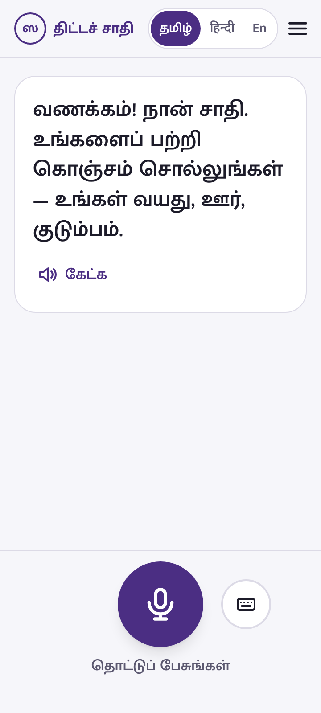
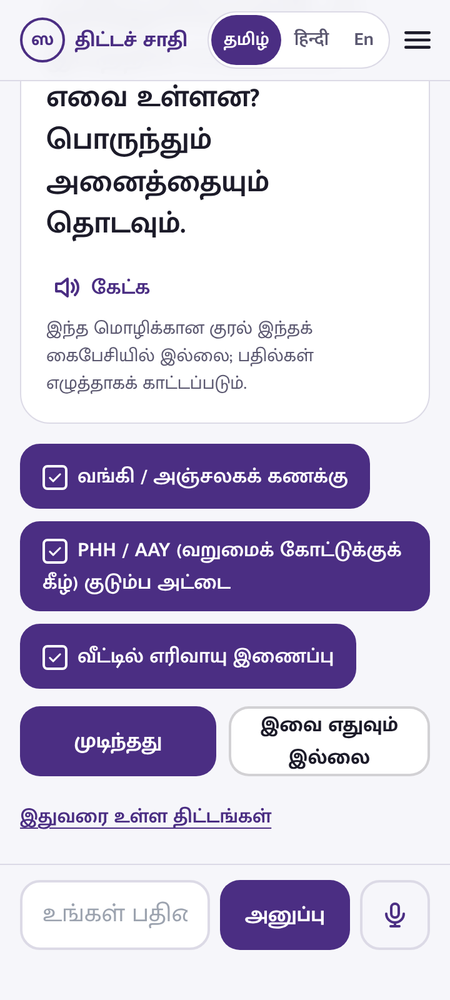
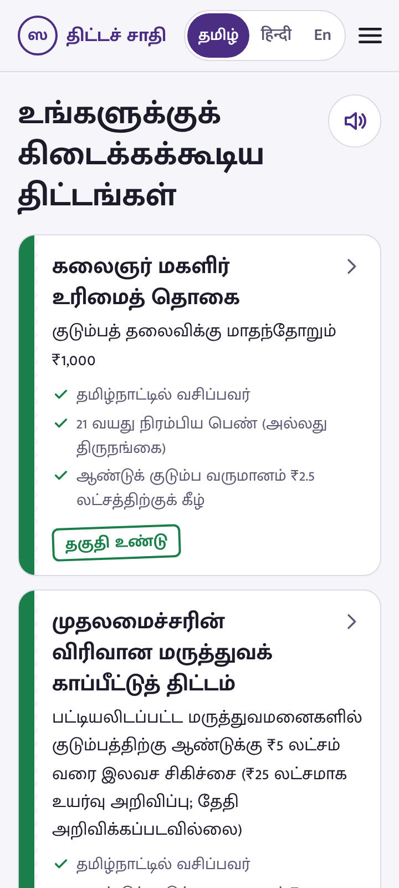
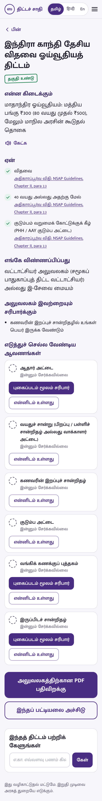
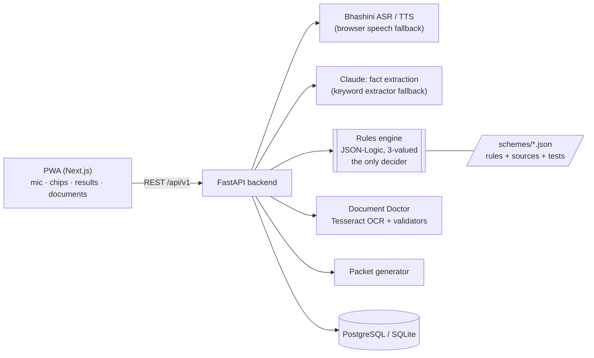

# SchemeSathi · திட்டச் சாதி · स्कीम साथी

**Speak in Tamil, Hindi or English. Find out which government welfare schemes you qualify for, why, which documents to bring, and get a ready packet for the office.**

Built for CodeQuest: National Tech Hackathon 2026 by Harini V M, Sri Sairam Engineering College.

- **Demo video (88 s):** [docs/schemesathi-demo.mp4](docs/schemesathi-demo.mp4), filmed from the running app, showing the full Lakshmi journey in Tamil
- **Live demo:** _deployment link to be added_. Until then, [run it locally](#run-it-locally) (no API keys needed)
- **Screenshots:** [docs/screenshots/](docs/screenshots/)

<p>




</p>

## The problem

India runs more than 4,000 welfare schemes, but eligible people miss out because of three walls: they don't know the schemes exist, they can't read text-heavy portals, and their applications fail on paperwork errors.

## The solution

A citizen taps one button and talks. SchemeSathi asks only the questions that matter for *them*, one at a time, with large tap-to-answer chips for every question. Then it shows the schemes they likely qualify for, each with the official clause it relied on. Document Doctor checks certificate photos for name mismatches, expiry and blur before the office does, and a PDF packet lists everything to carry.

**Core principle: the language model never decides eligibility.** It only turns speech into structured facts. A deterministic rules engine makes every decision and cites the official clause behind it.

## Architecture



One conversation turn:

1. The PWA records 16 kHz WAV (or uses the browser's speech recognition) and sends it with the chosen language.
2. Bhashini turns speech into text.
3. Claude returns new facts as JSON through a forced tool call whose schema is generated from the field registry. Invalid values are dropped. The keyword extractor fills gaps and takes over if Claude is slow or unavailable.
4. The rules engine evaluates all 17 schemes. Each is **eligible**, **not eligible** or **needs info**.
5. If facts are missing, the backend asks the question that unlocks the most undecided schemes.
6. The reply is spoken (Bhashini TTS, else the phone's voice) and shown on screen with answer chips.

## Features

| | |
|---|---|
| Voice-first, 3 languages | Tamil, Hindi, English. Every reply is spoken and shown. Typing and tap-to-answer always work. |
| Asks only what matters | Next-best-question picks the fact that unlocks the most schemes. Seven exclusion checks are one "tap all that apply" question. Lakshmi needs 7 follow-up answers after her first sentence. |
| Explained results | Eligible, almost eligible (one clause failed), needs info. Each clause links to its source. Warns when two schemes exclude each other (e.g. widow pension vs Magalir Urimai Thogai). |
| Life-event reminders | "At age 70, in 8 years: Ayushman Vay Vandana card." |
| Document Doctor | Photo → OCR → document type, name, dates. Flags name mismatch (fuzzy, tolerant of spelling and word order), expiry, stale income certificates, blur. Manual entry fallback. |
| Application packet | PDF helper sheet for the office: applicant facts, why they match, sources, document checklist. Plus a printable checklist in the citizen's own language. |
| Cited Q&A | "How much will I get?" is answered only from the scheme's encoded text, with sources. Says so when the answer isn't there. |
| Sahayak mode | A CSC operator or ASHA worker manages many families under one login, with quick entry. Data never mixes. |
| Privacy | Consent screen read aloud. Photos never stored. Aadhaar masked to last 4 digits. Document details auto-delete in 24 h. One-tap delete everything. |

## Schemes covered (17)

**Central:** Old Age Pension (IGNOAPS), Widow Pension (IGNWPS), Disability Pension (IGNDPS), PM-KISAN, Ayushman Vay Vandana (70+), Atal Pension Yojana, PMJJBY, PMSBY, PM Ujjwala, Sukanya Samriddhi, PM Matru Vandana, PM Vishwakarma, Post-Matric Scholarship for SC.
**Tamil Nadu:** Kalaignar Magalir Urimai Thogai, Pudhumai Penn, Tamil Pudhalvan, CMCHIS.

Every rule was checked against a source on 27 Oct 2026. Clauses marked `"quality": "secondary"` cite a reliable summary (news report, college notice) rather than the government order itself. `python scripts/validate_schemes.py` lists them; replace these with the official G.O./guideline PDF before a pilot.

## Tech stack

| Layer | Choice |
|---|---|
| Frontend | Next.js 15 (App Router, static export) + TypeScript + Tailwind CSS, installable PWA, self-hosted Mukta / Mukta Malar fonts |
| Voice | Bhashini ASR + TTS; browser Web Speech API fallback; 16 kHz WAV recorder in the browser |
| Backend | Python 3.11+, FastAPI, Pydantic v2, SQLAlchemy 2 |
| LLM | Claude via the Anthropic API (forced tool use for structured output). Optional. |
| Rules | JSON-Logic subset with three-valued logic (`backend/app/services/jsonlogic.py`, ~150 lines) |
| OCR | Tesseract (eng + tam + hin) via pytesseract; Pillow/NumPy for blur detection |
| Matching | rapidfuzz |
| PDF | reportlab |
| Database | PostgreSQL (Supabase / Neon / docker-compose) or SQLite with zero setup |
| Quality | pytest (137 tests), Playwright end-to-end, Ruff, ESLint, TypeScript, GitHub Actions |

## Run it locally

Fastest path (SQLite, no keys needed):

```bash
git clone https://github.com/<you>/schemesathi && cd schemesathi
cp .env.example .env                     # optional: add ANTHROPIC_API_KEY, BHASHINI_*, HASH_SALT

# backend
cd backend
python -m venv .venv && source .venv/bin/activate     # Windows: .venv\Scripts\activate
pip install -r requirements-dev.txt
uvicorn app.main:app --reload             # http://localhost:8000/docs

# frontend (second terminal)
cd frontend
npm install
echo "NEXT_PUBLIC_API_URL=http://localhost:8000" > .env.local
npm run dev                               # http://localhost:3000
```

Document Doctor needs Tesseract: `sudo apt install tesseract-ocr tesseract-ocr-tam tesseract-ocr-hin` (Linux), `brew install tesseract tesseract-lang` (macOS), or the [UB Mannheim installer](https://github.com/UB-Mannheim/tesseract/wiki) on Windows (tick Tamil and Hindi).

Everything in one container, with PostgreSQL:

```bash
docker compose up --build                 # http://localhost:8000
```

### Environment variables

See [`.env.example`](.env.example). All are optional; without keys the app runs on SQLite, the keyword extractor and the browser's speech engine. **Set `HASH_SALT` to a long random string before deploying.**

## Deploy (free tiers)

**One service (recommended):** create a Render "Web Service" from this repo using the `Dockerfile`. Set `DATABASE_URL` (Neon or Supabase), `HASH_SALT`, and optionally `ANTHROPIC_API_KEY` and `BHASHINI_*`. The container serves both the API and the PWA. Health check path: `/api/v1/health`.

**Split:** deploy `frontend/` to Vercel with `NEXT_PUBLIC_API_URL` set to the backend URL, and add the Vercel URL to the backend's `CORS_ORIGINS`.

Free instances sleep when idle. Open `/api/v1/health` a few minutes before judging or recording.

## How the rules engine works

Each scheme is one JSON file in `schemes/`. Its rule is the AND of its clauses, and each clause is a small JSON-Logic expression with its own text in three languages and its own source:

```json
{"id": "age", "rule": {">=": [{"var": "age"}, 60]},
 "text": {"en": "Aged 60 or above", "ta": "60 வயது அல்லது அதற்கு மேல்", "hi": "60 वर्ष या अधिक आयु"},
 "source": {"title": "NSAP Guidelines", "url": "https://…", "locator": "Chapter II, para 2.3", "quality": "official"}}
```

Clauses are evaluated with three-valued logic: true, false or unknown. So a scheme is ruled out the moment one clause is definitely false, and the app never asks irrelevant questions. Every decision is logged with the rules version (a content hash of all scheme files) and a salted hash of the inputs, with no personal fields.

### Add a scheme

1. Copy an existing file in `schemes/central/` or `schemes/tamil-nadu/`.
2. Encode each eligibility condition as a clause, using only fields from `backend/app/fields.py`. Copy thresholds from the official guideline and cite the page in `source.locator`.
3. Add `examples`: one profile that qualifies, and one that fails for each clause.
4. Run `python scripts/validate_schemes.py` and `pytest`.

## Testing and results

```bash
cd backend && pytest -q                                   # 137 tests: rules, API, extraction, OCR
python ../scripts/validate_schemes.py                     # scheme files and their examples
python ../scripts/eval_extractor.py                       # 30-utterance extraction set
BASE_URL=http://localhost:8000 pytest ../e2e -q           # Lakshmi journey in a 360×800 browser
```

| Measure | Result |
|---|---|
| Rule tests | 81 example profiles across 17 schemes. Every clause has a profile that fails it. All pass. |
| Eligibility evaluation | about 0.5 ms for all 17 schemes (target 300 ms) |
| Fact extraction, keyword extractor | 43/46 fields = 93% (en 89%, ta 93%, hi 100%), 0 invented sensitive facts |
| Lakshmi journey | one spoken sentence plus 7 follow-up answers to results, then document check, packet and delete-my-data, passing end to end on a 360×800 viewport |
| First-load JavaScript | about 122 kB (budget 1.5 MB) |

## Data and privacy

Designed to the principles of the Digital Personal Data Protection Act, 2023: consent, purpose limitation, data minimisation and the right to erasure.

- Consent screen in the user's language, read aloud, before the first question. Separate consent before every document upload.
- **Document photos are never stored.** They are read in memory and discarded. Only the extracted name, dates and certificate number are kept. Any 12-digit Aadhaar number is masked to its last 4 digits first.
- Document details auto-delete after 24 hours unless the user taps "Keep". Profiles inactive for 90 days are deleted.
- "Delete all my data" in every screen's menu removes the session, profiles, conversations and documents.
- Session tokens are stored only as salted hashes. Packet download links are HMAC-signed and expire in 10 minutes.
- Claude receives only the utterance text, never documents or IDs.
- Rate limiting on conversation, upload and Q&A endpoints.
- Every result says the final decision is made by the department.

## Disclosure

- **AI tools used:** this codebase (backend, frontend, scheme encoding, tests and this README) was written with Claude (Anthropic), directed and reviewed by the author. The scheme rules were researched by Claude from the cited web sources and must be verified by the author against the official guidelines. Tamil and Hindi interface text was machine-written and needs native-speaker review.
- **Runtime AI:** Claude (Anthropic API) for optional fact extraction and phrasing cited answers; Bhashini (MeitY) for optional speech.
- **Pre-existing components:** none beyond the open-source libraries below.
- **Third-party libraries:** FastAPI (MIT), Pydantic (MIT), SQLAlchemy (MIT), Uvicorn (BSD-3), httpx (BSD-3), Anthropic Python SDK (MIT), rapidfuzz (MIT), reportlab (BSD), Pillow (MIT-CMU), NumPy (BSD-3), pytesseract (Apache-2.0), Tesseract OCR (Apache-2.0), psycopg (LGPL-3.0), Next.js (MIT), React (MIT), Tailwind CSS (MIT), Fontsource Mukta / Mukta Malar fonts (SIL OFL 1.1), Playwright (Apache-2.0), pytest (MIT), Ruff (MIT).
- **Data sources:** NSAP guidelines (MoRD), PIB factsheets (PMJJBY, PMSBY, SSY, PM Vishwakarma, PM-KISAN), PFRDA APY FAQs, and secondary summaries listed per clause in `schemes/`. Persona names (Lakshmi, Arun) are fictional. All test documents are synthetic.

## Limitations and roadmap

**Known limitations of the prototype:**
- 17 schemes, not 50. Each one is fully sourced and tested; adding more is data entry plus review (see "Add a scheme").
- Eight schemes cite secondary sources and need their official government orders linked.
- Bhashini integration follows the public ULCA pipeline API but has not been tested against a live key in CI. Without a key the app uses the phone's speech engine, which on many Android phones has no Tamil voice, so replies are then shown as text.
- OCR uses Tesseract rather than PaddleOCR, to fit a free-tier container's memory. Handwritten or very low-quality certificates fall back to manual entry.
- The PDF packet is in English (for office staff); the citizen's-language version is the printable in-app checklist.
- Phone + OTP login is not implemented; sessions are anonymous device tokens.
- Rate limiting is in-memory (single instance).

**Roadmap:** district pilot with a CSC network; WhatsApp and IVR channels; all schemes for Tamil Nadu, then all 22 languages; consent-based DigiLocker integration; an open eligibility API for myScheme, UMANG and state portals.

## Licence

MIT. See [LICENSE](LICENSE).
